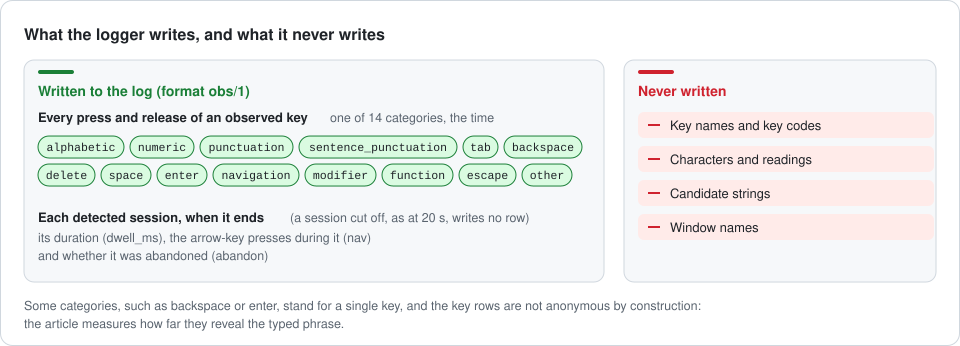
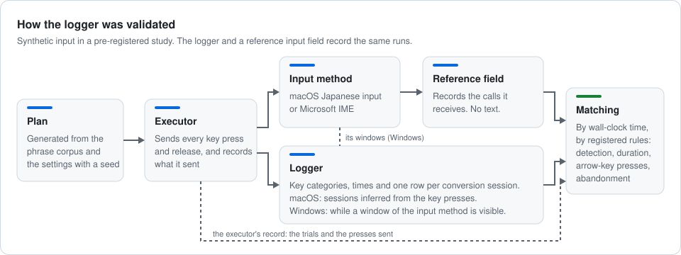

<p align="center"><a href="README.md">English</a> | <b>日本語</b></p>

<div align="center">

<picture>
  <source media="(prefers-color-scheme: dark)" srcset="assets/logo-dark.svg">
  
</picture>

# 文字を記録せずに日本語 IME の変換を記録する

**日本語入力の変換のまとまりを、その長さ・矢印キーの回数・取り消したかどうかとともに記録し、文字は 1 つも記録しないロガー。**

*観測できることの限界、両 OS で動くロガー、合成入力による検証*



[](https://doi.org/10.5281/zenodo.23183440)
[](https://doi.org/10.5281/zenodo.23183438)
[](#事前登録)

[](https://doi.org/10.5281/zenodo.23183440)
[](https://doi.org/10.5281/zenodo.23183438)
[](LICENSE-CODE)
[](LICENSE-DATA)


</div>

> [!IMPORTANT]
> この文書は英語版 [README.md](README.md) の訳です。内容が食い違うときは英語版を正とします。

書く研究で使われる打鍵のロガーは、日本語入力の変換を**記録しないか、文字ごと記録するか**のどちらかです。読みを綴るキーの名前や、変換中の文字列・画面の文字を記録するということです。このリポジトリは、その変換を**文字を記録せずに**観測することを扱う 1 本の論文の成果物をまとめたものです。Windows と macOS のどの公開の口で観測できるか、両 OS で動く**単体のロガー**、参照の入力欄と比べた**事前登録の検証**（合成入力）を含みます。文書に書いたコマンドは、すべてこのリポジトリの根から実行します。

> [!NOTE]
> 生ログはこのリポジトリに入っていません。データセット（[10.5281/zenodo.23183438](https://doi.org/10.5281/zenodo.23183438)）として寄託してあり、各書庫の SHA-256 は `experiment/data.md`（macOS）と `experiment/data.windows.md`（Windows）に記録してあります。

<p align="center">
  <a href="#すぐに試す">すぐに試す</a> ·
  <a href="#ロガーが記録するもの">ロガーが記録するもの</a> ·
  <a href="#ロガーの検証">検証</a> ·
  <a href="#解析を再現する">解析を再現する</a> ·
  <a href="#論文と引用">論文と引用</a> ·
  <a href="#リポジトリの構成">構成</a> ·
  <a href="#ライセンス">ライセンス</a>
</p>

## すぐに試す

キットの selftest と、2 つの合成の実行に対する解析の全段階を回します（実データは読みません）。

```bash
git clone https://github.com/mikotomiura/ime-conversion-logging.git
cd ime-conversion-logging
bash kit/check.sh
bash experiment/run.sh --synthetic
```

ロガーをビルドして動かし、そのログを形式と照らします（Rust と Cargo が必要です）。

```bash
cargo build --release --manifest-path kit/logger/Cargo.toml
kit/logger/target/release/ime-observation-logger --out obs.jsonl --duration-s 60
python3 kit/formats/validate_logs.py --kind obs obs.jsonl
```

macOS では、ロガーに「入力監視」の許可が要ります。許可が無いと、ロガーは許可を求める画面を出すようシステムに求めてから（まだ聞かれていなければ画面が出ます）、エラーで止まります。許可してから、もう一度起動してください。ロガーは既にあるログを上書きしません。ドライバ・オプション・制約は、ロガーの README（[`kit/logger/README.md`](kit/logger/README.md)、英語）に書いてあります。

## ロガーが記録するもの

<picture>
  <source media="(prefers-color-scheme: dark)" srcset="assets/records-dark.svg">
  
</picture>

ロガー（`kit/logger/`）は Windows と macOS で動きます。観測するキーを押すたび・離すたびに、14 のキーの分類のどれか 1 つと時刻を 1 行に書きます。検出した変換のまとまり（セッション）が終わると、その長さ、その間に押された矢印キーの回数、取り消したかどうかをまとめの 1 行に書きます。終わる前に打ち切られたまとまり（例えば 20 秒で）は行を書きません。どのキーを観測するかと、まとまりの検出の仕方は OS で違い、各 OS の規則は論文にあります。キーの名前とキーコードは捨てて分類だけを書きますが、`backspace` や `enter` のように 1 つのキーだけの分類もあります。文字・候補の文字列・読み・ウィンドウの名前は一切記録しません。ログの形式 `obs/1` は [`kit/formats/FORMATS.md`](kit/formats/FORMATS.md) に定めています。ただし、キーの行は作りの上で匿名なわけではありません。打った句をどこまで明かすかは、論文が測っています。

## ロガーの検証

<picture>
  <source media="(prefers-color-scheme: dark)" srcset="assets/validation-dark.svg">
  
</picture>

検証では、ロガーの行を参照と比べました。参照は、入力方法から受け取った呼び出しを記録する入力欄です。計画（プラン）を生成してキーを送ったのはプログラムで、実行の間に人が打つことは想定していません。測定は次の 3 つの設定で行いました。

| 設定 | 入力方法 | 試行の数 |
|---|---|---:|
| `macos-standard-live-on` | macOS の日本語入力、ローマ字入力、ライブ変換オン | 3,150 |
| `macos-standard-live-off` | 同じ設定でライブ変換オフ | 2,925 |
| `windows-msime-tsf` | Microsoft IME（日本語）、ローマ字入力、Text Services Framework のクライアントである参照の入力欄 | 2,925 |

macOS では、ロガーはキーの打鍵から変換のまとまりを推します。Windows では、入力方法のウィンドウが見えている間を 1 つのまとまりとし、これは参照の変換（composition）とは構成概念が違います。問い・解析・中止の規則は測定の前に事前登録してあり（[事前登録](#事前登録)）、そこからのずれは `experiment/deviations.md` に記録しています。

## 解析を再現する

1. データセット（[10.5281/zenodo.23183438](https://doi.org/10.5281/zenodo.23183438)）から各実行の書庫を取得します。データシート（`datasheet.md`、`experiment/` にも同じものがあります）が、すべてのファイルを説明し、すべての書庫と実行負荷の標本の SHA-256 を挙げています。
2. `experiment/data.md`（macOS）と `experiment/data.windows.md`（Windows）に従います。どちらも、結果のファイルごとに、作ったコード・コマンド・入力・出力の SHA-256 を記録しています。

結果のファイルは `experiment/results/` にあります。論文の表・本文で引く値・図は、`manuscript/tools/results_tables.py` がそれらから生成します。原稿のビルドの方法は `manuscript/BUILD.md` にあります。

## 論文と引用

> **Logging Japanese IME conversion without recording text: Observability limits, a cross-platform logger, and a synthetic-input validation**<br>
> Mikoto Miura（独立研究者）
>
> 論文は準備中で、原稿のソースは [`manuscript/`](manuscript/) にあります。事前登録: [macOS のセル](https://osf.io/9nh7r)・[Windows の追補](https://osf.io/4jwzn)。コード: [10.5281/zenodo.23183441](https://doi.org/10.5281/zenodo.23183441)。データ: [10.5281/zenodo.23183438](https://doi.org/10.5281/zenodo.23183438)。

コードの引用は `CITATION.cff` にあり、GitHub の "Cite this repository" に表示されます。BibTeX では次のとおりです。

```bibtex
@software{miura2026code,
  author    = {Miura, Mikoto},
  title     = {Logging {J}apanese {IME} conversion without recording text: Logger, validation kit and analysis code},
  version   = {1.0.1},
  year      = {2026},
  publisher = {Zenodo},
  doi       = {10.5281/zenodo.23219322},
  url       = {https://doi.org/10.5281/zenodo.23219322}
}

@dataset{miura2026data,
  author    = {Miura, Mikoto},
  title     = {Logging {J}apanese {IME} conversion without recording text: Records of the synthetic-input validation},
  year      = {2026},
  publisher = {Zenodo},
  doi       = {10.5281/zenodo.23183438},
  url       = {https://doi.org/10.5281/zenodo.23183438}
}
```

## 事前登録

| 登録 | 凍結した日 | 記録 | タグ |
|---|---|---|---|
| macOS のセル | 2026 年 10 月 2 日 | [osf.io/9nh7r](https://osf.io/9nh7r)（DOI 10.17605/OSF.IO/9NH7R） | `ime-observation-prereg-macos` |
| Windows の追補 | 2026 年 10 月 3 日 | [osf.io/4jwzn](https://osf.io/4jwzn)（DOI 10.17605/OSF.IO/4JWZN） | `ime-observation-prereg-windows` |

登録の本文は `experiment/preregistration.md`、そこからのずれは `experiment/deviations.md` にあります（どちらも英語）。

## リポジトリの構成

| ディレクトリ | 中身 |
|---|---|
| `kit/formats/` | ログの形式の契約と、その検証器 |
| `kit/corpus/` | 青空文庫の句とその読み |
| `kit/gen/` | シナリオの生成器 |
| `kit/emit/` | エミッタ（合成のキーの送出と、送ったキーの記録） |
| `kit/run/` | 1 つのセルの実行の取りまとめ |
| `kit/refinput-macos/`、`kit/refinput-windows/` | 参照の入力欄 |
| `kit/logger/` | 単体のロガー |
| `kit/pilot/` | 較正パイロットの道具 |
| `kit/analysis/` | 正解の組み立て、突き合わせ、L1、L2、パイプライン |
| `kit/e2/`、`kit/e3/` | 漏えいの評価、実行の負荷 |
| `experiment/` | 事前登録、ずれの記録、実行の記録（`data.md`、`data.windows.md`）、環境、結果、データセットのデータシート（`datasheet.md`、データと一緒にも寄託） |
| `manuscript/` | 原稿、補遺、それらをビルドする道具 |
| `assets/` | この文書の図と、それを作るスクリプト（`make_assets.py`） |

## このリポジトリの履歴

このリポジトリは、研究を進めた作業用のリポジトリの履歴を持ちません。履歴は次の順です。

1. macOS のセルの凍結の commit から書き出したファイル（タグ `ime-observation-prereg-macos`）
2. Windows の追補の凍結の commit から書き出したファイル（タグ `ime-observation-prereg-windows`）
3. 結果を解析する前の `manuscript/outline.md` だけを足した commit
4. リリース 1.0.0（タグ `v1.0.0`）
5. リリース 1.0.1（タグ `v1.0.1`）。`CITATION.cff`、`.zenodo.json`、2 つの README のほかに変えたのは、原稿の組版とその確かめだけです。頁に収まっていなかった 5 つの表（表 1、2、4、7、13）を次の頁へ続けられる形にし、ビルドが、頁の外や頁番号の上に文字や線がある頁を挙げて数えるようにもしました。原稿の文と値、ロガー、キット、解析のコード、結果はリリース 1.0.0 と同じで、表を作るスクリプトは表 13 の組み方だけが変わりました。

最初の 3 つの commit には元になった作業用の commit の日付を付け、メッセージでその commit を挙げています。ライセンスの全文、この文書の識別子と図、`.gitattributes` の行末の規則はリリース 1.0.0 で足しました。

<details>
<summary>凍結のタグの一覧を計算し直す</summary>

事前登録の 9 節が、凍結の commit から書き出したファイルの一覧を定めています。1 ファイル 1 行で、相対パス、空白、ファイルの SHA-256 を並べ、パスのバイト順に並べ、各行を LF で終えます。登録にはこの一覧の SHA-256 が書いてあります: `29b183ba245939ad82d9fa2d7db26e1a18520e2966f4aa9ec74478a4e51e6c49`（98 ファイル、`ime-observation-prereg-macos`）と `f61af353301e1370ac27c4a7425e8c2eb32991df9f7a2a765a26948da87787b7`（108 ファイル、`ime-observation-prereg-windows`）。2 つのタグの commit は `.gitattributes` を持たないので、ファイルを行末の変換なしで、新しい空のディレクトリに取り出します。次のスクリプトは SHA-256 とファイルの数を出し、渡した値と比べ、違えば 1 で終わります。

```bash
d=$(mktemp -d) && git -c core.autocrlf=false archive ime-observation-prereg-macos | tar -x -C "$d" &&
python3 - "$d" 29b183ba245939ad82d9fa2d7db26e1a18520e2966f4aa9ec74478a4e51e6c49 98 <<'EOF'
import hashlib, os, sys
root, want = sys.argv[1], (sys.argv[2], int(sys.argv[3]))
rows = sorted((os.path.relpath(os.path.join(d, n), root).replace(os.sep, "/").encode("utf-8"),
               hashlib.sha256(open(os.path.join(d, n), "rb").read()).hexdigest())
              for d, _, names in os.walk(root) for n in names)
text = b"".join(p + b" " + h.encode("ascii") + b"\n" for p, h in rows)
got = (hashlib.sha256(text).hexdigest(), len(rows))
print(*got, "match" if got == want else "MISMATCH")
sys.exit(0 if got == want else 1)
EOF
```

Windows のタグでは、同じコマンドを `ime-observation-prereg-windows`、その SHA-256、108 で回します。`core.autocrlf=true`（Git for Windows の既定）では書庫が CRLF の行末で書かれ、一覧が一致しません。

</details>

## 検証

```bash
bash kit/check.sh              # kit/ の下の selftest をすべて回す（何もしなければ赤とみなす）
bash kit/check.sh --compile    # kit/ の下のすべての .py を py_compile する
bash kit/check.sh --self-test  # この入口自身の陰性対照
```

- `--selftest` で回すのは、`kit/` の下の `.py` のうち、目印のコメント `# kit: selftest` を持つものだけです（目印の無い補助のモジュールはコンパイルだけします）。目印は、**行全体が `# kit: selftest` であるコメント**として書きます（文字列の中の目印は拾いません）。
- この入口は検証と受け入れの確かめのたびに回るので、**selftest は既定で速く書きます**（1 本 30 秒未満。超えると警告が出ます）。重い確かめは `--selftest --full` のように分け、既定では回しません。
- ログの形式の契約は [`kit/formats/FORMATS.md`](kit/formats/FORMATS.md) です。`gt` と `obs` の行の**形**（文字列の値が列挙か正規表現に合い、知らないキーやエスケープが無いこと）は `kit/formats/validate_logs.py` が機械で確かめます。整数の値・版の文字列・`manifest_sha256` の意味は範囲の外で、ログに中身を入れないこと（種類・長さ・時刻だけを書くこと）は書く側の責任です。FORMATS.md の "Scope of guarantee" を参照してください。

## ライセンス

ディレクトリではなく、種類で分けています。

| 種類 | ライセンス | 全文 |
|---|---|---|
| コード（`.py`、`.sh`、`.swift`、`.rs` などのソース） | Apache License 2.0 | `LICENSE-CODE` |
| データ（`kit/corpus/data/` の句と読みを含む）と文書（`*.md`、`experiment/` の記録、`manuscript/`） | Creative Commons Attribution 4.0 International | `LICENSE-DATA` |
